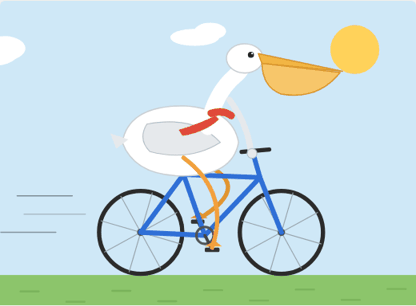
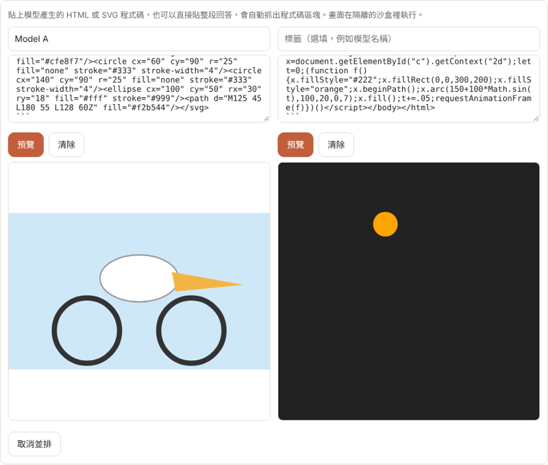
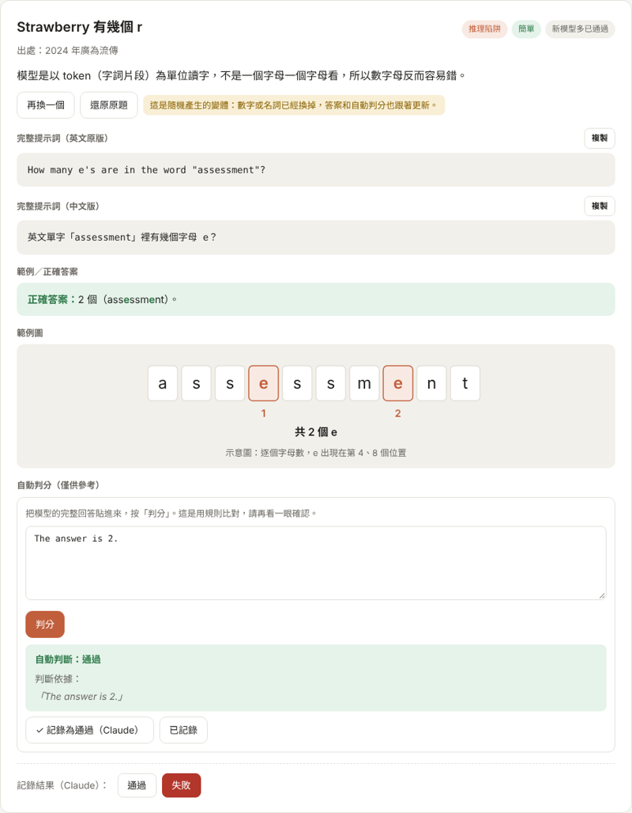
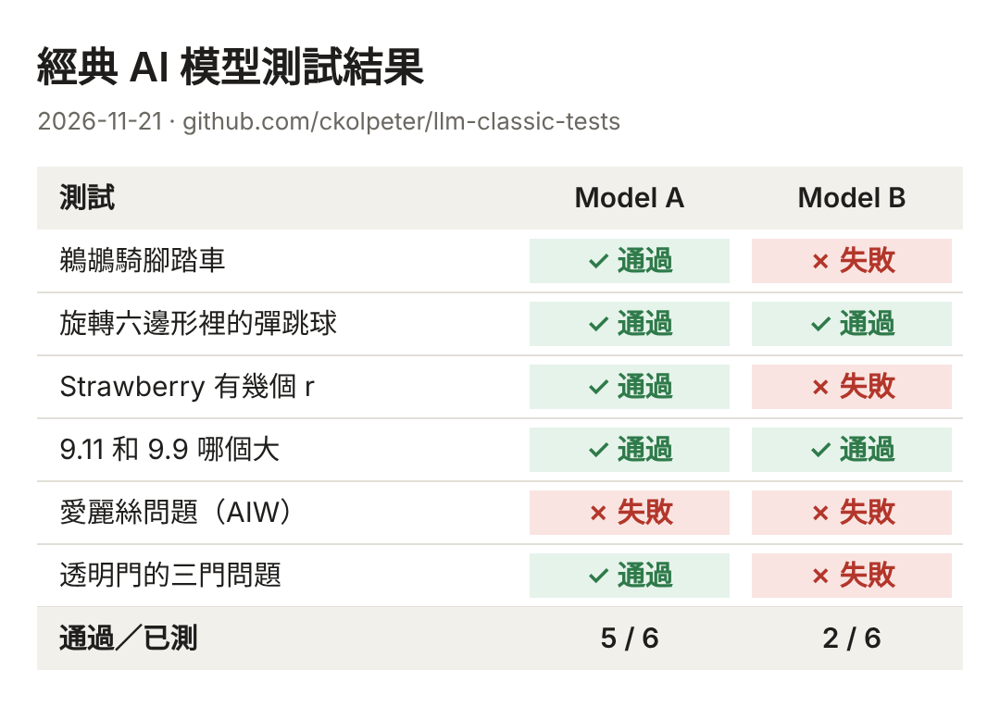

# Classic LLM Tests

[中文](README.md) | **English**

A collection of the classic large language model (LLM) tests that circulate online, packaged as a single web page you can open and use right away: from "a pelican riding a bicycle" and "a ball bouncing in a spinning hexagon" to "how many r's are in strawberry" — 35 tests in total.

**Use it online:** https://ckolpeter.github.io/llm-classic-tests/ (once GitHub Pages is enabled)


## Features

- **35 classic tests** in six categories: drawing & coding, reasoning traps, instruction following, Chinese language, knowledge & honesty, and long context
- **English and Chinese prompts**: the English originals (so you can compare with results shared online) plus Chinese versions, each with a copy button
- **Answers or grading criteria**, difficulty labels (easy / medium / hard) and a "mostly solved by new models" marker
- **Example figures**: working animated examples for the drawing and coding tests (pelican, bouncing balls, Snake, 3D cube, Game of Life, a playable piano…) and diagrams for the reasoning tests
- **Paste & preview**: paste the HTML/SVG a model produced (or its whole reply) and see it rendered in a secure sandbox, with an optional side-by-side view for two models
- **Auto-grading**: for the 21 tests with a fixed answer, paste the model's reply to get a pass/fail verdict and record it in one click (rule-based, for reference)
- **Random variants**: 17 tests can swap their numbers or nouns in one click ("an octopus riding a skateboard", "how many s's in mississippi", a freshly generated sudoku), with the answer and grading updated automatically so models can't rely on memorization
- **Record results**: add the models you're comparing, mark each test Pass or Fail, and get a comparison table; records stay in your browser
- **Export** the comparison as CSV (opens in Excel) or as a PNG image for sharing
- **English / Chinese interface** and **light / dark theme** toggles
- A single HTML file: **no install, works offline** — download and double-click

<p align="center"></p>

## How to use

1. Open the online page above, or download [`index.html`](index.html) and open it in a browser.
2. Pick a test, press **Copy**, and paste the prompt into the AI model you want to test.
3. Judge the result:
   - Drawing & coding tests: paste the model's output into **Paste the model's output to preview it** to see it rendered.
   - Tests with auto-grading: paste the model's reply into **Auto-grading** and press **Grade**.
   - Everything else: compare with the "Answer / what to look for" section.
4. To compare several models, add them under **Record results**, mark each test Pass or Fail, then view or export the **Comparison table**.
5. Worried a model memorized the original? Press **Random variant** for a fresh version.

| Paste & preview, side by side | Random variant + auto-grading |
| --- | --- |
|  |  |



> Start a fresh conversation for each test, and run each test a few times to check consistency. The longer a prompt has been around, the more likely models have memorized it — try changing numbers or nouns (an octopus instead of a pelican) for a fairer test.

## Tests included

| Category | Count | Tests (difficulty) |
| --- | --- | --- |
| Drawing & coding | 11 | Pelican riding a bicycle (Medium), 3D pelican on a bicycle (WebGL) (Hard), Ball bouncing in a spinning hexagon (Medium), 20 balls in a spinning heptagon (advanced) (Hard), SVG clock at 10:10 (Medium), Playable piano keyboard (Medium), Hand-coded rotating 3D cube (Medium), Playable Snake in one shot (Easy), Tetris in one shot (Medium), Flappy Bird in one shot (Easy), Conway's Game of Life (Easy) |
| Reasoning traps | 12 | How many r's in strawberry (Easy), Which is bigger, 9.11 or 9.9 (Easy), Alice in Wonderland (AIW) problem (Medium), Modified river-crossing puzzle (Medium), Monty Hall with transparent doors (Medium), 1 kg of iron vs 1 kg of cotton (original) (Easy), 2 pounds of feathers vs 1 pound of bricks (Easy), The surgeon riddle without the riddle (Medium), Large multiplication (Medium), Spell a word backwards (Easy), If yesterday were tomorrow (Medium), Solve a sudoku (Hard) |
| Instruction following | 2 | Every sentence ends with "apple" (Medium), Write without a letter (Hard) |
| Chinese language | 6 | "I almost didn't fall" (差點沒) (Medium), "Nobody can beat / they can't beat anybody" (Easy), Punctuating 下雨天留客天留我不留 (Medium), Spotting misused idioms (Medium), Simplified-to-traditional traps (Medium), Zhuyin (Bopomofo) (Easy) |
| Knowledge & honesty | 3 | A paper that doesn't exist (hallucination) (Medium), Einstein's two Nobel Prizes? (Easy), Knowledge cutoff and today's date (Easy) |
| Long context | 1 | Needle in a haystack (Hard) |

## What these tests are (and aren't) good for

These quick tests are easy to run and the results are obvious at a glance, so they catch things formal benchmarks miss — like whether a model is just pattern-matching a memorized answer. But they have few items, results vary run to run, and they may have leaked into training data, so **they are not a rigorous way to rank models**. For real comparisons, combine formal evaluations with your own hands-on experience.

## Project layout

```
index.html        the page (test data embedded, works offline)
tests.json        all test data — edit this to add or change tests
build.py          embeds tests.json into index.html and validates the data
docs/             screenshots and animation for the README
```

After editing `tests.json`, run:

```bash
python build.py          # update index.html
python build.py --check  # validate only, change nothing
```

## Contributing

New tests, translation fixes and UI improvements are all welcome! See [CONTRIBUTING.md](CONTRIBUTING.md), or just [open a "New test" issue](../../issues/new/choose) and fill in the form.

## Credits

- Pelican riding a bicycle: [Simon Willison](https://simonwillison.net/tags/pelican-riding-a-bicycle/)
- Balls in rotating shapes: the X (Twitter) community, [TechCrunch](https://techcrunch.com/2025/01/24/people-are-benchmarking-ai-by-having-it-make-balls-bounce-in-rotating-shapes), [Artificial Analysis MicroEvals](https://artificialanalysis.ai/microevals/balls-bouncing-inside-a-spinning-hexagon-1750176234580)
- 20 balls in a spinning heptagon: the r/LocalLLaMA community
- Alice in Wonderland problem: *Alice in Wonderland: Simple Tasks Showing Complete Reasoning Breakdown in State-Of-the-Art Large Language Models* (2024)
- Needle in a haystack: Greg Kamradt
- Sudoku puzzle: the example puzzle from Wikipedia's "Sudoku" article
- Other tests are well-known community puzzles or variants of them

The original ideas belong to their creators. The example figures were made by Claude as a reference for what a good answer roughly looks like; they are not real outputs from other models. This project's curation, translations, page and figures are released under the MIT license.

## License

[MIT License](LICENSE)
