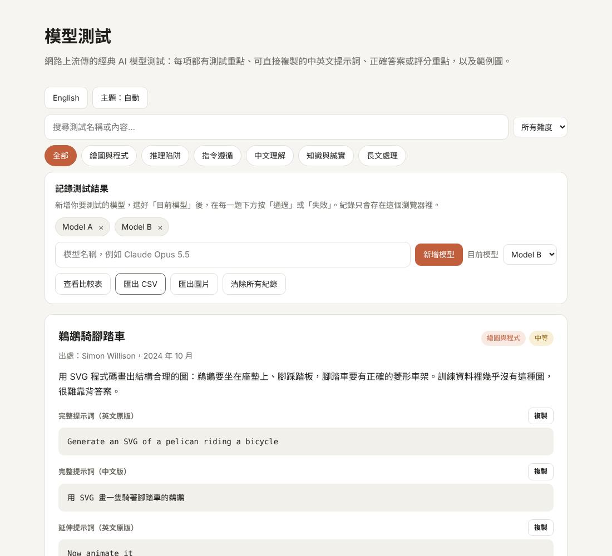
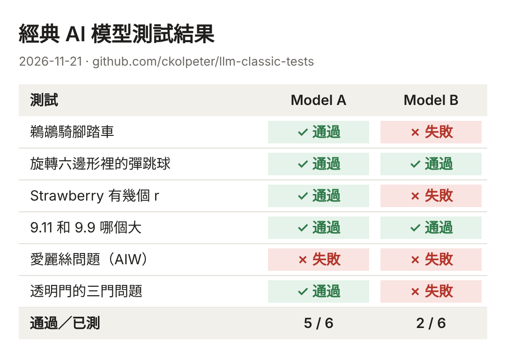

# 模型測試：經典 AI 模型測試合集

**中文** | [English](README.en.md)

收錄網路上流傳的經典大型語言模型（LLM）測試，整理成一個打開就能用的網頁：從「鵜鶘騎腳踏車」、「旋轉六邊形彈跳球」到「strawberry 有幾個 r」，共 35 個測試。

**線上使用：** https://ckolpeter.github.io/llm-classic-tests/ （需先開啟 GitHub Pages）



## 功能

- **35 個經典測試**，分成繪圖與程式、推理陷阱、指令遵循、中文理解、知識與誠實、長文處理六類
- **中英文提示詞**：英文原版（方便和網路上的結果比較）＋中文版，一鍵複製
- **正確答案或評分重點**，以及難度標籤（簡單／中等／困難）和「新模型多已通過」標記
- **範例圖**：繪圖和程式題附上能實際運作的動畫範例（鵜鶘、彈跳球、貪食蛇、3D 立方體、生命遊戲、可以彈的鋼琴…），推理題附上解題示意圖
- **記錄測試結果**：新增要比較的模型，逐題按「通過／失敗」，自動產生比較表；紀錄存在你的瀏覽器裡
- **匯出**：比較表可匯出成 CSV（Excel 可開）或 PNG 圖片，方便分享
- **中英介面切換**、**淺色／深色主題切換**
- 單一 HTML 檔，**不需安裝、不需網路**，下載後雙擊就能用

<p align="center"></p>

## 使用方式

1. 開啟上面的線上網址，或下載 [`index.html`](index.html) 後用瀏覽器打開。
2. 挑一個測試，按「複製」，貼到你想測試的 AI 模型對話框裡。
3. 對照「範例／正確答案」判斷模型表現。
4. 想比較多個模型的話，在「記錄測試結果」新增模型，逐題按「通過」或「失敗」，最後到「結果比較表」查看或匯出。



> 建議每次都開新對話測試；同一題可以多跑幾次，看結果是否穩定。題目流傳越久，越可能被模型「背」起來，可以試著換掉數字或名詞（例如把鵜鶘換成章魚）再測。

## 收錄的測試

| 分類 | 題數 | 測試（難度） |
| --- | --- | --- |
| 繪圖與程式 | 11 | 鵜鶘騎腳踏車（中等）、3D 鵜鶘騎腳踏車（WebGL）（困難）、旋轉六邊形裡的彈跳球（中等）、旋轉七邊形 20 顆球（進階版）（困難）、SVG 時鐘 10:10（中等）、可以彈的鋼琴鍵盤（中等）、手寫 3D 旋轉立方體（中等）、一次寫出能玩的貪食蛇（簡單）、一次寫出俄羅斯方塊（中等）、一次寫出 Flappy Bird（簡單）、康威生命遊戲（簡單） |
| 推理陷阱 | 12 | Strawberry 有幾個 r（簡單）、9.11 和 9.9 哪個大（簡單）、愛麗絲問題（AIW）（中等）、改編版過河問題（中等）、透明門的三門問題（中等）、一公斤鐵和一公斤棉花（原版）（簡單）、兩磅羽毛和一磅磚塊（簡單）、沒有矛盾的外科醫生謎題（中等）、大數乘法心算（中等）、單字倒著拼（簡單）、如果昨天是明天（中等）、解數獨（困難） |
| 指令遵循 | 2 | 每句都以 apple 結尾（中等）、不能用某個字母或字（困難） |
| 中文理解 | 6 | 「我差點沒摔倒」（中等）、「中國足球隊誰也贏不了」（簡單）、下雨天留客天留我不留（中等）、成語誤用判斷（中等）、簡轉繁陷阱（中等）、注音符號（簡單） |
| 知識與誠實 | 3 | 不存在的論文（幻覺測試）（中等）、愛因斯坦得了兩次諾貝爾獎？（簡單）、知識截止日期與今天日期（簡單） |
| 長文處理 | 1 | 長文找針（Needle in a haystack）（困難） |

## 這些測試的意義與限制

這類小測試好上手、結果一眼就看得懂，能補足正式基準測試（benchmark）看不到的地方，例如模型是否只是套用背過的答案。但它們題數少、每次結果可能不同，也可能已經混進訓練資料，**不適合當作嚴謹的模型評比**。真的要比較模型，請搭配正式評測與實際使用經驗。

## 專案結構

```
index.html        網頁本體（題目資料已內嵌，可離線使用）
tests.json        所有測試題目的資料（要新增或修改題目請改這裡）
build.py          把 tests.json 內嵌進 index.html，並檢查資料格式
docs/             README 用的截圖與動畫
```

修改 `tests.json` 後，執行：

```bash
python build.py          # 更新 index.html
python build.py --check  # 只檢查，不修改
```

## 參與貢獻

歡迎新增測試、修正翻譯或改善網頁！請先看 [CONTRIBUTING.md](CONTRIBUTING.md)。也可以直接[開一個「新增測試」Issue](../../issues/new/choose)，填好表單就行。

## 出處與致謝

- 鵜鶘騎腳踏車：[Simon Willison](https://simonwillison.net/tags/pelican-riding-a-bicycle/)
- 旋轉形狀彈跳球：X（Twitter）社群、[TechCrunch 報導](https://techcrunch.com/2025/01/24/people-are-benchmarking-ai-by-having-it-make-balls-bounce-in-rotating-shapes)、[Artificial Analysis MicroEvals](https://artificialanalysis.ai/microevals/balls-bouncing-inside-a-spinning-hexagon-1750176234580)
- 旋轉七邊形 20 顆球：Reddit r/LocalLLaMA 社群
- 愛麗絲問題：論文 *Alice in Wonderland: Simple Tasks Showing Complete Reasoning Breakdown in State-Of-the-Art Large Language Models*（2024）
- 長文找針：Greg Kamradt
- 數獨題目：維基百科「數獨」條目的範例題
- 其他題目為網路社群流傳的經典題或其改編版

各測試的原始創意屬於原作者。網頁中的範例圖由 Claude 製作，是「好答案大概長什麼樣子」的參考，不是其他模型的實際輸出。本專案的整理、翻譯、網頁與範例圖以 MIT 授權釋出。

## 授權

[MIT License](LICENSE)
